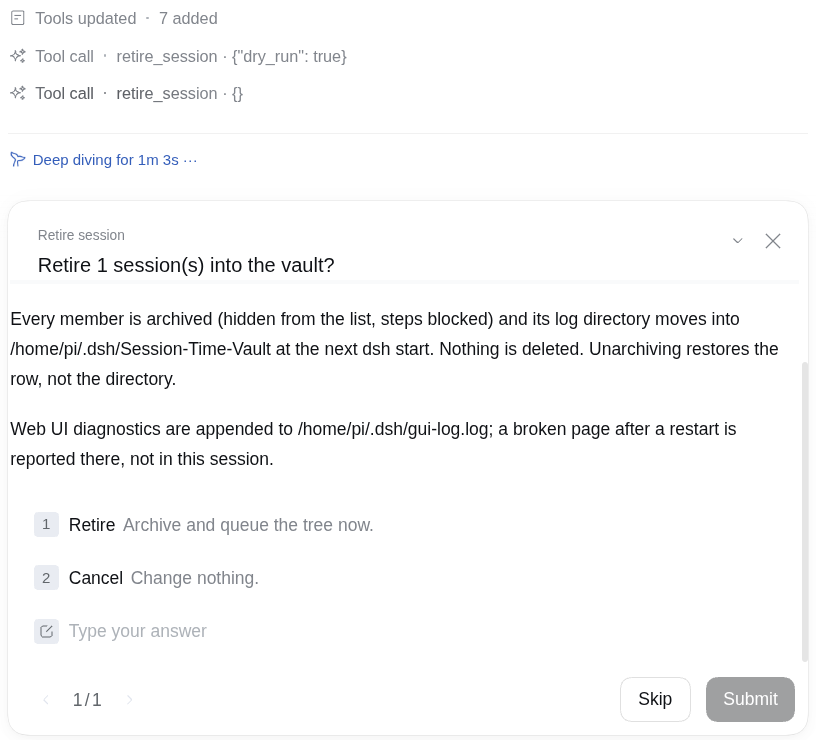
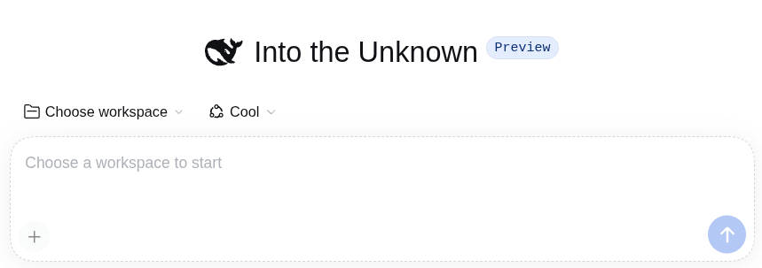

# retire-this-session

Retire a DSH session together with its forked and subagent descendants: archive
the tree now, move the log directories into the Session-Time-Vault at the next
start.

Nothing is deleted. Work still running in the tree is cancelled, not killed, and
no `systemd` unit hook is involved, so the plugin behaves identically on Linux,
macOS, and Windows.

## Usage

1. Tell the session to retire itself.

   

2. Choose **Retire** in the confirmation.

   

3. The session moves to the retired list and is hidden, and a new session starts
   immediately.

   

## What it does

`retire_session` (model-facing tool):

`retire_session dry run` — call it with `dry_run: true` to see the plan without
changing anything: it reads the headers, builds the tree, resolves each member's
directory, and reports them. It asks no question, archives nothing, queues
nothing, and never reaches the confirmation in step 3 or the archiving after it.
Use it to inspect the tree before the real call.

1. reads every stored header, including archived forks that the UI does not show;
2. builds the tree as the transitive closure of `parentSession` from the calling
   session;
3. asks the human in the UI to confirm (options `Retire` / `Cancel`) and does
   nothing unless `Retire` is chosen — the tool has no self-approval path, and
   without the `userQuestions` service it refuses rather than proceeding;
4. refuses when the root has no log or when a member's `cwd` differs from the
   root's, or when a member is pinned; an already-archived member is skipped
   instead of refused, so a partly retired tree can still be finished and a
   second call is a no-op;
5. writes each member's artifact directory to
   `<dshHome>/session-retirement-queue.json` **before** archiving anything;
6. archives every member through
   `ctx.workspaceRegistry.archiveSession(id, { stopActivity: true })`, children
   first and the root last, which is reversible, hides the session from every
   grouping surface, blocks its next step, drops any pin, cancels any turn, job,
   subagent, or schedule still running in the tree, and emits the change event
   the Web UI already reacts to.

Because the root's archive cancels the calling turn, `retire_session` returns as
`aborted` even when the retirement succeeded. The archive event in the UI is the
authoritative outcome, and the session does not accept another step.

At the next start the plugin drains that queue, after `ctx.inject` hands it the
workspace registry and the session store: `rename` into
`<dshHome>/Session-Time-Vault/<id>`, falling back to copy-then-remove when the
vault is on another filesystem. A live session, an existing vault entry, a
vanished directory, and an entry whose session is no longer archived are all
handled without failing the rest; survivors stay queued. The archive gate is
what keeps a crash between the queue write and the archive from moving the log
of a session that is still listed, and waiting for the registry is what keeps a
startup earlier than the registry from postponing the drain indefinitely.

## Why not move immediately

The JSONL backend appends with `open(path, 'a')` → write → fsync → close, and the
lease verifies the locked inode against the lock path. Renaming a live session's
directory makes the next append recreate the old path: the vault gets a truncated
log and the split continues silently. At startup nothing holds those files, so
the move is safe — and portable, which is what a `systemd` `ExecStopPost` hook is
not.

## Where retired logs go, and the Web UI log

The retired directories are the backup: they move to
`<dshHome>/Session-Time-Vault/<session-id>` and stay there. Unarchiving restores
the list row, not the directory.

The Web UI's own diagnostics go to `<dshHome>/gui-log.log` (boot manifest, failed
`/api` calls, script errors). Some setups append there through a separate logging
plugin; retirement never touches it either way. When a page misbehaves after a
restart, read that file before blaming the retirement:

```sh
tail -n 50 ~/.dsh/gui-log.log
```

The confirmation dialog prints both paths.

## Install

```sh
dsh plugin --profile web add retire-this-session
```

Restart the service once (`systemctl --user restart dsh`, or stop and start it
however you run DSH) so the new bundle composes. The `retire_session` tool then
appears in the next session.

To work on a local checkout instead:

```sh
dsh plugin --profile web add "retire-this-session@link:$PWD"
```

Verify composition (also writes `cordis.yml` into the profile, so run it outside
the service's read-only sandbox):

```sh
dsh --profile web --dump-config | grep session-retirement
```

## Config

The patch row needs no config; every path defaults from `$DSH_HOME` (or `~/.dsh`
when it is unset). Override a path from the profile's `cordis.patch.yml` when
needed; relative values resolve against `$DSH_HOME`:

```yaml
- id: session-retirement
  config:
    vaultDir: Session-Time-Vault
    queueFile: session-retirement-queue.json
    guiLogFile: gui-log.log
```

## Uninstall

Archive and unarchive stay DSH's own state and can be changed from the UI at any
time. Removing the plugin stops the drain; already-archived sessions keep their
flags and their logs stay in `sessions/`. A non-empty
`session-retirement-queue.json` then needs a manual move.

## Tests

```sh
node --test test/*.test.js
```

Twenty-two tests cover the tree closure, every refusal, directory discovery,
queue atomicity, the drain's move/live/archived/existing/missing behaviour,
root-last archiving with rollback, and the archive path against a host that
refuses an active session unless `stopActivity` is passed.

## License

MIT. See [LICENSE](LICENSE).
